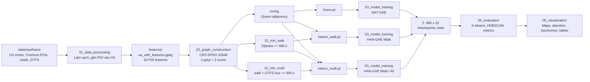
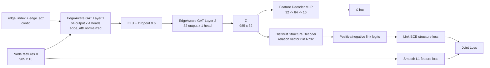
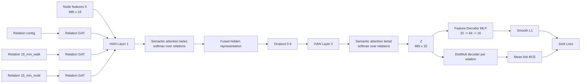

# GIAI ĐOẠN 3

## TÀI LIỆU THIẾT KẾ KIẾN TRÚC MÔ HÌNH VÀ PIPELINE

**Tên dự án:** City2Graph-Hanoi  
**Phạm vi:** 985 ô H3 Resolution 9 trong 27 phường nội đô Hà Nội  
**Mục tiêu tài liệu:** mô tả luồng dữ liệu, schema trung gian, kiến trúc GAT-GAE/HAN-GAE và các tham số thực nghiệm cố định.

---

## 1. Nguyên tắc thiết kế

Kiến trúc được tổ chức theo nguyên tắc tách biệt bốn lớp:

1. **Data layer:** dữ liệu nguồn và tiền xử lý không gian.
2. **Graph layer:** các quan hệ đô thị được chuyển thành edge store của PyTorch Geometric.
3. **Representation layer:** encoder học embedding từ thuộc tính nút, thuộc tính cạnh và topology.
4. **Analysis layer:** decoder/loss dùng khi huấn luyện; embedding đầu ra được chuyển sang phân cụm và diễn giải không gian.

Mọi artefact được đánh số theo pipeline để bảo đảm một đầu ra của pha trước là đầu vào rõ ràng của pha sau.

---

## 2. Sơ đồ luồng dữ liệu và pipeline

### 2.1. Sơ đồ tổng quát

### 2.2. Các pha biến đổi

| Pha | Đầu vào | Phép biến đổi | Đầu ra chuẩn |
|---|---|---|---|
| 1. Raw ingestion | POI, đường, GTFS, H3, phường | đọc, kiểm tra CRS, chuẩn hóa định danh | lớp dữ liệu nguồn sạch |
| 2. Feature aggregation | POI + H3 polygons | spatial join và gom nhóm Overture | 16 nhóm POI/ô H3 |
| 3. Feature scaling | 16 nhóm POI | `log1p` rồi z-score theo cột | ma trận $X \in \mathbb{R}^{985\times16}$ |
| 4. Street graph | segments, connectors, centroid | nối ô H3 với mạng đường và tính thời gian | street nodes/edges |
| 5. Walking relation | street graph + centroid | Dijkstra với cutoff 900 giây | `15_min_walk` |
| 6. Multimodal relation | walking graph + GTFS | thêm bus stop, bus legs, thời gian chờ giả định | `15_min_multi` |
| 7. PyG packaging | node/edge GeoDataFrames | ánh xạ ID sang index tensor | `homo.pt`, `hetero_walk.pt`, `hetero_multi.pt` |
| 8. GNN training | PyG graph + $X$ | encoder, decoder, joint loss | checkpoint, $Z$, $\beta$ |
| 9. Evaluation | $Z$ và graph relations | clustering, modularity, DBCV | CSV, figures, maps |

### 2.3. Chi tiết tạo quan hệ cạnh

#### Quan hệ `contig`

- Đơn vị: ô H3 (`oa`) đến ô H3 (`oa`).
- Tiêu chuẩn: Queen contiguity, tức hai ô có chung cạnh hoặc chung đỉnh.
- Vai trò: biểu diễn lân cận vật lý và làm đồ thị đồng nhất cho GAT-GAE.
- Thời gian cạnh: khoảng cách giữa các điểm đại diện chia cho vận tốc đi bộ $1.3333$ m/s trong pipeline.

#### Quan hệ `15_min_walk`

- Xây dựng trên mạng `street_connector` và các cầu nối từ ô H3 đến mạng đường.
- Trọng số Dijkstra là `travel_time_sec`.
- Chỉ giữ các cặp ô có đường đi ngắn nhất không vượt quá 900 giây.
- Quan hệ được lưu dạng `('oa', '15_min_walk', 'oa')` với `edge_attr` là thời gian di chuyển.

#### Quan hệ `15_min_multi`

- Khởi đầu từ mạng đi bộ.
- Bổ sung điểm dừng xe buýt, các đoạn liên tiếp theo GTFS và cầu nối ô H3/trạm.
- Có thành phần thời gian chờ xe buýt giả định trong trọng số kết nối.
- Chạy Dijkstra với cùng cutoff 900 giây.
- Quan hệ lưu trong `hetero_multi.pt` là tập transit-only được tách khỏi các cặp đã có trong walking relation; vì vậy tên `15_min_multi` trong graph là quan hệ mở rộng xe buýt, không phải toàn bộ combined raw edge set.

### 2.4. Đóng gói PyTorch Geometric

| File | Kiểu | Nội dung |
|---|---|---|
| `homo.pt` | `Data` | nút `oa`, `x`, `edge_index`, `edge_attr` cho `contig` |
| `hetero_walk.pt` | `HeteroData` | node store `oa`; edge stores `contig`, `15_min_walk` và các bridge/network stores cần thiết |
| `hetero_multi.pt` | `HeteroData` | node store `oa`; `contig`, `15_min_walk`, `15_min_multi` và stores giao thông hỗ trợ |

Quy ước quan trọng:

- `edge_index` chứa chỉ số tensor, không phải mã H3 nguyên bản.
- Thứ tự node phải nhất quán với thứ tự 985 ô dùng để tạo ma trận $X$.
- `edge_attr` có một chiều thời gian/trọng số cho các quan hệ được truyền vào EdgeAwareGAT.
- Heterogeneous graph giữ tên quan hệ để HAN-GAE có thể dùng một nhánh attention riêng cho từng relation/metapath.

---

## 3. Đặc tả kiến trúc mạng nơ-ron

### 3.1. Sơ đồ khối GAT-GAE

### 3.2. EdgeAwareGAT encoder

Trong triển khai, `GATConv` nhận thêm `edge_attr`, do đó attention của nút được tính có điều kiện theo thông tin cạnh. Trước khi truyền vào lớp GAT:

1. Nếu thuộc tính cạnh không âm, dùng `log1p`.
2. Chuẩn hóa bằng BatchNorm1d theo chiều cạnh.
3. Nếu thuộc tính có giá trị âm, áp dụng BatchNorm trực tiếp.

Với một lớp GAT tổng quát:

$$
\mathbf{h}^{(\ell+1)}_i=
\sigma\left(
\sum_{j\in\mathcal{N}(i)}
\alpha^{(\ell)}_{ij}
W^{(\ell)}\mathbf{h}^{(\ell)}_j
\right),
$$

trong đó $\alpha_{ij}$ được học từ biểu diễn nút và thuộc tính cạnh. Multi-head attention nối (`concat=True`) các đầu ở lớp 1; lớp cuối dùng một head để tạo đúng 32 chiều.

### 3.3. Sơ đồ khối HAN-GAE

### 3.4. HAN node-level attention

Với mỗi metapath/quan hệ $r$, HAN có một GAT riêng:

$$
H_{i,r}=\mathrm{GAT}_r(H_i,E_r).
$$

Các nhánh có thể sử dụng cùng ma trận đầu vào nhưng không chia sẻ bộ lọc GAT giữa các quan hệ. Điều này giúp mô hình phân biệt:

- lân cận địa lý trực tiếp (`contig`);
- khả năng tiếp cận qua mạng đi bộ (`15_min_walk`);
- mở rộng tiếp cận nhờ xe buýt (`15_min_multi`).

### 3.5. HAN semantic attention và trọng số $\boldsymbol{\beta}$

Các biểu diễn quan hệ được xếp chồng thành tensor:

$$
H_{stack}\in\mathbb{R}^{985\times |\mathcal{R}|\times d_r}.
$$

Mỗi biểu diễn được chiếu qua một lớp tuyến tính, đưa qua `tanh`, sau đó tính điểm với vector attention học được $q$:

$$
s_{i,r}=q^T\tanh\left(W_sH_{i,r}\right),
\qquad
\beta_{i,r}=\frac{e^{s_{i,r}}}{\sum_{r'}e^{s_{i,r'}}}.
$$

Embedding hợp nhất là:

$$
z_i=\sum_{r\in\mathcal{R}}\beta_{i,r}H_{i,r}.
$$

Vì $\sum_r\beta_{i,r}=1$, các cột `beta1_*`/`beta2_*` có thể được dùng để so sánh tương đối giữa các relation tại cùng một ô. Không được diễn giải $\beta$ là xác suất hoặc tác động nhân quả.

### 3.6. Feature decoder

Đối với các model có thuộc tính, decoder MLP có cấu trúc:

$$
\hat{X}=W_2\,\mathrm{ELU}(W_1Z+b_1)+b_2,
$$

với kích thước `32 -> 64 -> 16`. Decoder cố gắng tái tạo vector POI đã chuẩn hóa, không tái tạo số POI thô.

Trong Models 1S-4S, feature decoder không được khởi tạo và feature loss bằng 0.

### 3.7. DistMult structure decoder

Đối với một cạnh dương $(u,v)$ của quan hệ $r$:

$$
s_r(u,v)=\sum_{k=1}^{32}z_{u,k}\,r_k\,z_{v,k}
=\left(z_u\odot r\odot z_v\right)^T\mathbf{1}.
$$

GAT-GAE có một vector quan hệ cho `contig`. HAN-GAE có một vector DistMult riêng cho mỗi metapath. Các cạnh âm được lấy bằng negative sampling với tỷ lệ mặc định 1:1 so với cạnh dương.

### 3.8. Joint Loss

#### Link BCE

Với logits cạnh dương $s^+$ và cạnh âm $s^-$:

$$
\mathcal{L}_{\mathrm{struct}}
=\mathrm{BCEWithLogits}(s^+,1)
+\mathrm{BCEWithLogits}(s^-,0).
$$

Đối với HAN-GAE, loss cấu trúc được tính riêng cho từng metapath rồi lấy trung bình:

$$
\mathcal{L}_{\mathrm{struct}}^{HAN}
=\frac{1}{|\mathcal{R}|}
\sum_{r\in\mathcal{R}}\mathcal{L}_{\mathrm{struct},r}.
$$

#### Smooth L1

$$
\mathcal{L}_{\mathrm{feat}}=\mathrm{SmoothL1}(\hat{X},X).
$$

#### Hàm mất mát tổng

Đặc tả trong code huấn luyện là:

$$
\boxed{\mathcal{L}=\mathcal{L}_{\mathrm{feat}}+
\lambda_{\mathrm{struct}}\mathcal{L}_{\mathrm{struct}}.}
$$

Với Models 1-4, cả hai thành phần được tối ưu. Với Models 1S-4S:

$$
\mathcal{L}=\mathcal{L}_{\mathrm{struct}},
\qquad \mathcal{L}_{\mathrm{feat}}=0.
$$

Trong tài liệu cấu hình có trường `model.loss.alpha` để mô tả ý tưởng cân bằng hai thành phần; khi mô tả kết quả thực thi, phải ưu tiên công thức và giá trị được notebook truyền vào `compute_loss`, tức `lambda_struct` và loss thực tế của checkpoint.

---

## 4. Cấu hình huấn luyện và vòng đời artefact

### 4.1. Siêu tham số cố định

| Nhóm | Tham số | Giá trị |
|---|---|---:|
| Input | số node | 985 |
| Input | số feature | 16 |
| Encoder | số lớp | 2 |
| Encoder | hidden dimension | 64 |
| Encoder | số heads lớp 1 | 4 |
| Encoder | embedding dimension | 32 |
| Regularization | dropout | 0.6 |
| Optimizer | Adam learning rate | 0.005 |
| Optimizer | weight decay | 0.0001 |
| Training | số epoch tối đa | 200 |
| Training | early stopping patience | 100 |
| Sampling | negative sampling ratio | 1.0 |
| Reproducibility | seed chính | 42 |

### 4.2. Vòng đời một lần huấn luyện

1. Đọc PyG `Data` hoặc `HeteroData` lên CPU/GPU theo cấu hình.
2. Khởi tạo encoder và decoder với seed 42.
3. Forward pass để tạo $Z$, $\hat{X}$ và $\beta$ nếu là HAN-GAE.
4. Tính feature loss, structure loss và joint loss.
5. Backpropagation bằng Adam.
6. Lưu state tốt nhất theo joint loss; dừng sớm nếu không cải thiện trong 100 epoch.
7. Khôi phục state tốt nhất và chạy inference ở chế độ `eval()`.
8. Lưu checkpoint, `Z_*.npy`, các cột embedding trong PyG object và `beta_*.npy` cho HAN-GAE.

### 4.3. Kích thước tensor chính

| Tensor | Kích thước | Ý nghĩa |
|---|---:|---|
| `oa.x` | `985 × 16` | đặc trưng POI chuẩn hóa |
| hidden lớp 1 | `985 × (64×4)` | biểu diễn sau multi-head concat |
| hidden lớp 2 | `985 × 32` | embedding đầu ra |
| `Z` | `985 × 32` | ma trận embedding dùng phân cụm |
| `beta` Model 2/3 | `985 × 2` mỗi lớp | trọng số `contig` và một quan hệ tiếp cận |
| `beta` Model 4 | `985 × 3` mỗi lớp | trọng số ba quan hệ |
| `X_hat` | `985 × 16` | tái tạo thuộc tính |

---

## 5. Mapping model-to-graph

| Model | File graph | Metapaths/edge relation | Decoder cấu trúc |
|---|---|---|---|
| Model 1 | `homo.pt` | `contig` | một vector DistMult |
| Model 2 | `hetero_walk.pt` | `contig`, `15_min_walk` | hai vector DistMult |
| Model 3 | `hetero_multi.pt` | `contig`, `15_min_multi` | hai vector DistMult |
| Model 4 | `hetero_multi.pt` | `contig`, `15_min_walk`, `15_min_multi` | ba vector DistMult |
| Model 1S | `homo.pt` | `contig` | structure-only |
| Model 2S | `hetero_walk.pt` | `contig`, `15_min_walk` | structure-only |
| Model 3S | `hetero_multi.pt` | `contig`, `15_min_multi` | structure-only |
| Model 4S | `hetero_multi.pt` | cả ba quan hệ | structure-only |

---

## 6. Hợp đồng đầu ra cho pha đánh giá

Pha huấn luyện được xem là hợp lệ khi bàn giao được:

- checkpoint tương ứng cho từng model;
- embedding có đúng shape `985 × 32`;
- không có NaN/Inf trong embedding;
- beta của HAN-GAE có đúng số cột theo số quan hệ và tổng mỗi hàng xấp xỉ 1;
- tên node/order của embedding khớp với `zone_id` của GeoDataFrame;
- graph relation tồn tại và `edge_index` không chứa chỉ số ngoài phạm vi;
- loss history và best epoch được lưu hoặc có thể truy xuất từ artefact;
- dữ liệu đủ để pha 4 chạy K-Means, HDBSCAN và tính Modularity.

Các kiểm tra trên là hợp đồng giao diện giữa pha Model Training và pha Evaluation. Chúng không khẳng định rằng embedding đã tìm được “sự thật” duy nhất về cấu trúc chức năng đô thị; chúng chỉ bảo đảm đầu ra đúng schema và sẵn sàng cho kiểm định tiếp theo.

---

## 7. Các điểm cần lưu ý khi trình bày bảo vệ

1. `edge_attr` là thời gian/trọng số cạnh sau biến đổi số học; không nên gọi trực tiếp là xác suất hoặc lưu lượng.
2. Attention $\alpha$ cấp cạnh và semantic attention $\beta$ cấp quan hệ là hai đại lượng khác nhau.
3. Model 4 tận dụng cả ba quan hệ, nhưng không bắt buộc phải đạt Silhouette cao nhất; lợi ích có thể thể hiện rõ hơn qua Modularity và khả năng diễn giải.
4. Structure-only là ablation để đo đóng góp của thuộc tính POI, không phải baseline cạnh tranh ngang hàng với mô hình đầy đủ.
5. Việc huấn luyện tự giám sát trên toàn đồ thị không tạo ra accuracy như bài toán có nhãn; các chỉ số clustering phải được gọi đúng là đánh giá nội tại.
6. Với HDBSCAN, các phép đo Modularity trên tập non-noise phải được ghi chú riêng để tránh so sánh sai với K-Means trên đủ 985 nút.

---

## Kết luận

Kiến trúc City2Graph-Hanoi biến dữ liệu đô thị đa nguồn thành một không gian biểu diễn thống nhất theo ba bước: **chuẩn hóa thuộc tính**, **xây dựng quan hệ tiếp cận**, và **học embedding bằng graph autoencoder có attention**. GAT-GAE cung cấp đối chuẩn đồng nhất; HAN-GAE mở rộng sang học đa quan hệ với trọng số $\beta$; DistMult và Joint Loss buộc embedding đồng thời giữ thông tin thuộc tính và cấu trúc. Thiết kế này tạo giao diện rõ ràng giữa dữ liệu, mô hình và pha đánh giá, phù hợp để kiểm toán trong đồ án tốt nghiệp.
